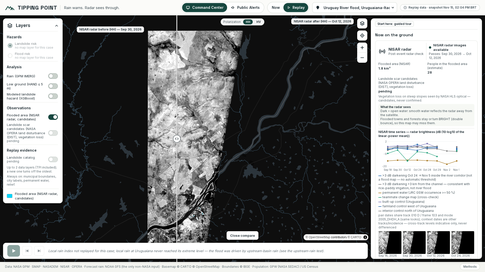
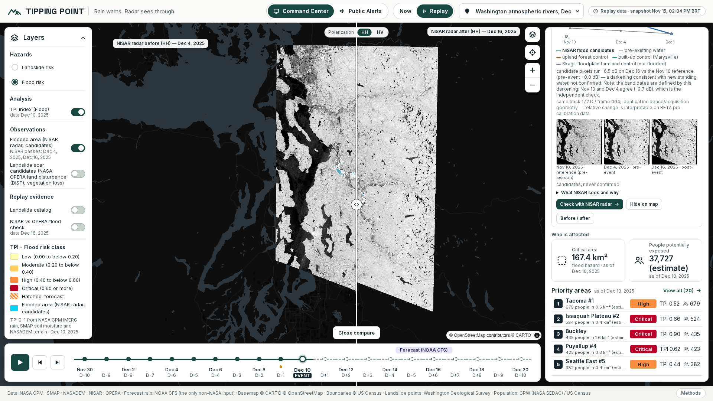
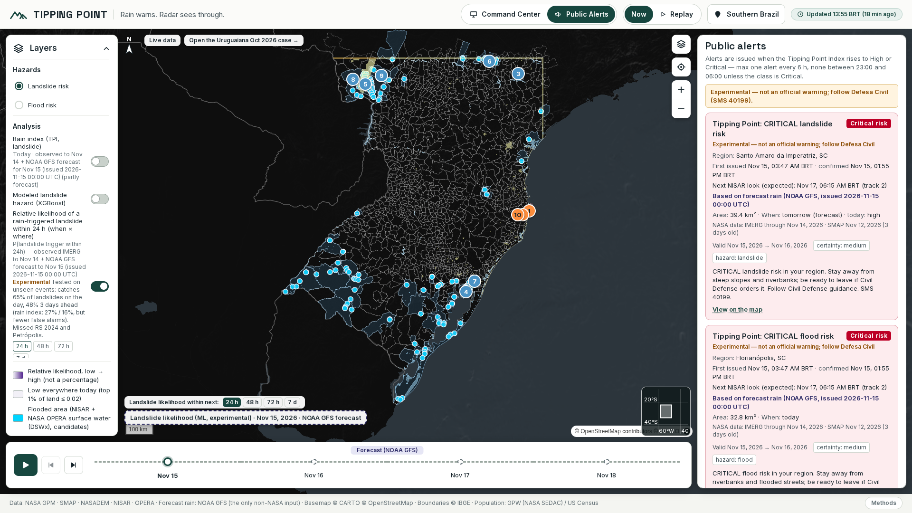

# Tipping Point

**Rain warns. Radar sees through.** NASA Space Apps Challenge 2026 — challenge #5 "Dancing with the SARs".

**Live demo:** [https://tippingpoint.l17s.dev](https://tippingpoint.l17s.dev) · **License:** Apache-2.0 · **Team:** [TEAM NAME]

This repository holds the whole project: the data and analysis pipeline at the repo root and the web app in [`app/`](app/) (its own README: [`app/README.md`](app/README.md)). The former `r2l2pj/tipping-point-app` repository was merged in with its history and is frozen. The contract between the pipeline and the app is [`data/SCHEMA.md`](data/SCHEMA.md) — read it first; the app never computes and never globs. Which calendar days a frame labelled X covers is in [`docs/conventions-dates.md`](docs/conventions-dates.md).

## What it is

Tipping Point turns NASA data into when, where and who in floods and landslides. Main case: the **Uruguay River at Uruguaiana** (Rio Grande do Sul, Brazil). In October 2026 the Uruguay River at Uruguaiana stayed above its 8.50 m flood stage on Oct 5–21 (ANA gauge). Replayed with the data as it was available, our index, fed by NASA satellite rain, turned the Uruguaiana region Critical on Sep 30, five days before flood stage, and NOAA's GFS forecast from Sep 27 already pointed there, 8 days ahead (near-real-time rain; it holds when scaled to the final product; 3 small false alarms on Sep 20–22). It found the right days, not yet the right streets; NISAR passes every 12 days then saw the water through cloud, and about 98,000 people live on the low floodplain. Supporting cases: Washington State, December 2025 (NISAR flood candidates under 92.9% cloud) and Rio Grande do Sul, May 2024 (a replay with each NOAA GFS forecast as it was issued). The live "Now" job refreshes Southern Brazil every 3 hours.

| Uruguaiana, Oct 2026 — NISAR | Washington, Dec 2025 — NISAR | Live public alerts (experimental) |
|---|---|---|
|  |  |  |

## How it works (short)

- **Inputs:** NISAR GCOV (L-band radar), GPM IMERG (rain), SMAP L4 (soil moisture), NASADEM + height above drainage (terrain), GPW v4.11 (people), VIIRS Black Marble (night lights), NASA OPERA DSWx / DIST-ALERT and HLS (water and scar candidates), SWOT (river levels). Forecast rain: NOAA GFS 0.25°, the only non-NASA input.
- **Index:** TPI = (R·S·T)^(1/3), uniform weights; Critical > 0.6 only when rain, soil and terrain all agree ([Method and thresholds](#method-and-thresholds)).
- **Radar:** HH backscatter drop > 3 dB below a per-scene threshold, low ground near rivers, ≥ 3 ha → flood candidates; pairs with mismatched modes, threshold fallbacks or swath-edge patches are rejected.
- **ML (experimental):** XGBoost trigger model beside the index; an independent audit found it about as good as a simple forecast-rain-vs-local-extreme rule ([07-overfit-audit](docs/science-review/07-overfit-audit.md)).

## Honest results

| Check | Result | Caveat |
|---|---|---|
| Washington: NISAR flood candidates | 27.99 km² within the swath, about 950 people inside | post pass covers 74% of the area; BETA products |
| Washington: NISAR vs NASA OPERA surface water (C-band), new flood | F1 0.15 (precision 0.19, recall 0.13) | double bounce: 45% of the missed flood is in towns or forest vs 5% of what was caught (`data/wa_2025/nisar_hypothesis.json`) |
| Rio Grande do Sul 2024: landslides, forecast as issued | 5.8% of 16,027 mapped landslides High or Critical in the forecast issued 27 h before the first deaths, which flagged 2.1% of the area: 2.7× chance | runs issued 51 and 75 h before: 0% ([docs/replay-v2.md](docs/replay-v2.md)) |
| Forecast lead (replays, horizon 0–3 days) | about 1 day in Rio Grande do Sul; none for Washington's flooded places (0% at 24/48/72 h) | official warnings came first in both replays |
| Uruguaiana 2026 (replay) | Critical over the Uruguaiana region on Sep 30 (13,129 km², 6,121 on the low floodplain), 5 days before flood stage; the NOAA GFS run of Sep 27 already showed Critical on the floodplain for Sep 29–30 (8 days ahead); 54% of the NISAR flood candidates (a teammate's polygons) lie on the floodplain, which is 28% of the land (1.92×); about 98,000 people on the floodplain | near-real-time rain, holds scaled to the final product (3,541 km² on the floodplain); 15 Critical days Sep 15–Oct 31, 3 small ones (Sep 20–22) with no flood stage within 10 d; Critical area only 1.34× concentrated on the floodplain; numbers depend on the case box; at 6-hour resolution the region first passes 1,000 km² Critical on Sep 29, 03:00 BRT (smooth by construction: frames share 66 of 72 rain hours); our stricter automatic NISAR check did not reproduce the teammate polygons |
| ML trigger model | median per-event ROC 0.93 over 9 held-out disasters | about as good as a simple rule; ~4–5 alarm-days per site per year |

More: [Declared limitations](#declared-limitations), `data/metrics.json`, `docs/science-review/`.

## Data products and where they are published

`data/` (contract: [`data/SCHEMA.md`](data/SCHEMA.md)) holds per-case COG / PNG / GeoJSON / JSON plus `data/now/` and the root `data/manifest.json` (written last). The live workflow force-pushes `data/` to the orphan branch **`fallback`** every ~3 h; the app reads it from `https://raw.githubusercontent.com/r2l2pj/tipping-point/fallback/data/`, then from its server-side copy of `data/tipping_point.sqlite` (the `docs` table holds every app-facing JSON; one row per Now run in `runs`), then from its bundled `app/public/data` copy. `now.yml` rebuilds the SQLite file and publishes it on `fallback`. Neon is no longer used (L53). Large static rasters are attached to the GitHub Release `static-v1`.

## Credits and attributions

NASA data: NISAR, GPM IMERG, SMAP, NASADEM, NASA OPERA DSWx and DIST-ALERT, HLS, VIIRS Black Marble, SWOT, GPW v4.11 (SEDAC), Global Landslide Catalog / COOLR. Forecast rain: NOAA GFS. Required attributions: NASA OPERA DSWx-S1 contains modified Copernicus Sentinel-1 data (ESA); Copernicus Emergency Management Service EMSR720 © European Union (independent validation maps); Washington Geological Survey landslide inventory; UFRGS/Cemaden landslide inventory; IBGE boundaries; ANA (Brazil) river-gauge telemetry; JRC Global Surface Water; MERIT Hydro (validation only).


## Repo map

| Path | What it holds |
|---|---|
| `app/` | The web app: Next.js 16 (App Router) + bun + MapLibre — `src/` (Command Center UI; data reader `src/lib/data.ts`), `public/data/` (bundled last-resort copy of the artifacts), `docs/`, `submission/` (Space Apps texts) |
| `pipeline/` | `tp/` processing package, `scripts/` thin CLIs numbered in run order, `fetch/` downloaders, `tests/` |
| `live/` | "Modo agora" live pipeline — `run_now.py`, `jobs.py` (scheduled job orchestrator), fetch/render/publish/alerts |
| `gee/` | Earth Engine scripts — JS (Code Editor) plus Python ports (`python -m gee.tpi --case …`); asset namespace in `gee/README.md` |
| `ml/` | Experimental XGBoost trigger/susceptibility model + `lead_time.py` |
| `tools/` | `publish_case.py` (per-case app bundle), `build_manifest.py` (root manifest, always last), `build_sqlite.py`, `ingest_assets.py`, `now_tpi.py` |
| `data/` | Published artifacts (COG/GeoJSON/JSON per case + `now/`); contract `data/SCHEMA.md`; `data/raw/` is gitignored |
| `events/` | One JSON per event: AOI, dates, NISAR frames |
| `static/`, `intermediate/` | Local fallback arrays for `run_now.py --local`; pipeline intermediates |
| `docs/` | Runbooks (`DEPLOY-VPS.md`, `EARTHDATA_TOKEN.md`), `replay-v2.md`, `science-review/` |
| `.github/workflows/` | `now.yml` (live job every ~3 h), `now-watchdog.yml`, `nisar.yml`, `validation.yml`, `reference.yml`, `app-ci.yml`, `app-keepalive.yml` |
| repo root | `pyproject.toml` / `uv.lock` / `Makefile` / `config.yaml` (pipeline toolchain); `Dockerfile` + `.dockerignore` (builds `app/`; the build context is the repo root) |

## Quick start

Pipeline (repo root; Python via [uv](https://docs.astral.sh/uv/)):

```bash
uv sync                                                    # creates .venv
uv run pytest pipeline/tests gee/tests live/tests ml/tests # 1024 passed, no credentials needed
make all CASE=rs_2024      # replay chain for one case (rs_2024 | wa_2025)
make now                   # live "modo agora" chain (live/jobs.py now)
```

`make test` runs the same tests plus the ruff linter, which currently reports lint findings. Steps that need credentials print `SKIP <step>: missing <var>` and the chain still exits 0 — a bare `env -i make all CASE=rs_2024` exercises the whole wiring with no secrets. Replay chain order (`make all`): GEE TPI series → HAND → impact → NISAR fetch → terrain → flood mask → polygonize → OPERA+HLS validation → perfect-forecast layers → landslide hit-rate → HLS scar → lead time → case publish → root manifest (always last — `data/SCHEMA.md` explains why).

Web app (`app/`, [bun](https://bun.sh)):

```bash
cd app
bun install --frozen-lockfile
bun test                   # 785 pass, 0 fail
bun run build              # prebuild syncs the repo-root data/ into app/public/data
bun run start              # production server on :3000 (bun run dev for development)
```

Container (repo root): `docker build -t tipping-point-app .` (or `podman build`), then run it as in [`docs/DEPLOY-VPS.md`](docs/DEPLOY-VPS.md); `/api/health` answers 200.

## Credentials

| Variable | Needed for |
| --- | --- |
| `EARTHDATA_TOKEN` | NASA Earthdata downloads: NISAR GCOV, OPERA DSWx, HLS, SWOT, IMERG/SMAP live fetches |
| `GEE_PROJECT` | Google Earth Engine cloud project (shared, team) — all `gee/` and GEE-backed steps |
| `GOOGLE_APPLICATION_CREDENTIALS` **or** `GCP_SA_KEY` | Earth Engine service-account JSON key (path, or raw JSON for `GCP_SA_KEY`). Keep the key out of the repo |

Local fallback: `EDL_USER`/`EDL_PASS` or a `~/.netrc` entry for
`urs.earthdata.nasa.gov` (see `.env.example`). CI sets `EARTHDATA_TOKEN`,
`GCP_SA_KEY` and `GEE_PROJECT` (`.github/workflows/now.yml`). There is no
Cloud Storage bucket (ruling L10): `tools/export_fallback.py` renders
fallback files locally into `data/`, and the live workflow pushes `data/`
to the orphan branch `fallback`, which the app reads via
`DATA_BASE_URL=https://raw.githubusercontent.com/r2l2pj/tipping-point/fallback/data/`.

## Domains and the rain climatology

`config.yaml` carries a `domains` block alongside `cases`: `domains.now`
(name `south_brazil`, W/S/E/N bbox) is the live coverage area, read via
`tp.config.now_bounds()` / `tp.config.now_name()` (same bbox as
`live.config.NOW_BOUNDS`, same name as `live.config.STATIC_DOMAIN`).

The 3-day-rain climatology backing the R-score percentiles lives in GEE as an
ImageCollection per coverage area, **int16 mm×10** storage (~0.9 GB total —
divide by 10 on read):

- `tipping-point/<case>/clim_rain` — per case: ~25 images, the doys of the
  case event window, clipped to that case AOI.
- `tipping-point/static/south_brazil/clim_rain` — for the live job: a rolling
  ~75-doy window over the `domains.now` bbox.

Interface is unchanged in both: one image per doy with a `doy` property and
bands `p90|p95|p99` (3-day-sum mm percentiles, ~10 km). Readers filter on
`doy` and scale by 0.1.

## Method and thresholds

TPI = geometric mean of three scores in [0,1], per `config.yaml thresholds`:

- **R** (rain): piecewise score of the 3-day IMERG sum against that doy's
  climatological p90/p95/p99 (`rain_percentiles: [90, 95, 99]`).
- **S** (soil): SMAP L4 `sm_rootzone_wetness` rescaled over
  `soil_wetness_range: [0.5, 0.9]`.
- **T** (terrain): slope (NASADEM, `slope_range_deg: [15, 30]`) for
  TPI_slide; HAND proxy (`hand_range_m: [5, 15]`, zeroed above 5° slope)
  for TPI_flood. Classes at `tpi_classes: [0.2, 0.4, 0.6]`, weights
  `tpi_weights` (uniform = plain geomean).

Flood mask (NISAR, ruling A2 — calibration choice): **adaptive per-scene
Otsu threshold** on GCOV backscatter change (`water_db_max: -15` is the
fallback/clamp only), median 3×3, `flood_db_drop: -3` dB drop, HAND < 15 m
gate, bright-flood layer, 3-ha minimum mapping unit. (WA 2025 as published:
Otsu did not fire, so the −15 dB fallback set the threshold — see Declared
limitations.) Coherence landslide
candidates use `coherence_drop: 0.3` / `coherence_ref_min: 0.4` with
elevation/snow/flood exclusion gates — declared but **moot for wa_2025**
(no GUNW pair crosses the event; candidates come from HLS optical instead).

Real-forecast replay (rulings L22, L28, L28b): for every issue day D of a
case window the replay re-creates what a forecaster had at D 00Z —
observed IMERG for days ≤ D−1 only (no look-ahead), the **NOAA GFS 0.25°
00Z run of D** for days D..D+3, SMAP S held at D−1 (doc level 2), static T.
Frame "D+k" (k = 1..3) is the 3-day accumulation ending D+k, each calendar
day counted once (`pipeline/tp/forecast_align.py`). GFS precipitation is read
from the NOAA AWS bucket `noaa-gfs-bdp-pds` (APCP 6-h buckets via `.idx`
byte ranges, decoded with GDAL) and every replay COG is checked against the
GDAL-sampled GRIB (`data/gfs_replay_verification.json`: 37 issue days × 24
cells, 0 mismatches). Frames are labelled `forecast: NOAA GFS (issued
<date>)`. The older perfect-forecast layers (observed inputs at D+k) remain
only as a labelled **upper bound**, never the headline. Live Modo Agora also
uses NOAA GFS (`forecast_source: "noaa-gfs"`, L25) with SMAP held at the
latest observation.

Forecast lead time (L22, `data/<case>/forecast_lead_time.json`, mirrored in
`metrics.json cases.<id>.forecast_lead_time`; onset-anchored version in
`cases.<id>.forecast_lead_time_onset`): an issue day "warns" when any frame
depicting a date on/before the documented event onset has a pixel with TPI
> 0.6 (slide or flood) **anywhere in the AOI** — a lenient any-pixel test,
not at the damage locations (see `*_warned` for those). Onset-anchored
values (L37): **rs_2024 median 87 h** (onset 2024-04-29 00:00 BRT; earliest
issue 2024-04-23, 147 h; 2 of 7 issue days warned), **wa_2025 median 80 h**
(onset 2025-12-08 00:00 PST; earliest 2025-12-03, 128 h; 5 of 8 warned — all
five from landslide cells somewhere in the AOI, none from the flooded
valleys). Issue days after the onset cannot score and are not in the
denominator; an issue day whose D−1 SMAP is missing is skipped and listed.
Official warnings still came before the index — the project never claims
earlier-than-official.

Lead time (`ml/lead_time.py`): per damage-point `lead_hours =
anchor − first Critical crossing`; metrics carry `lead_time_median_h`,
`lead_time_iqr_h`, `lead_time_mean_h`, `warned_before_pct`,
`warned_24h_pct`, `never_critical_pct`, `n_points`, `n_points_excluded`,
`alto_n_points` (Alto-threshold counts), `anchor_precision`,
`event_lead_h`, `official_warning_delta_h`, `critical_area_km2`,
`critical_area_with_damage_pct`, plus a 6-h `lead_time_hist` and
`lead_time_assumptions`. Null fields ship with a reason string, never a
silent 0.

Lead-time counts (observed replay, anchor = first damage report):
- rs_2024 (5,678 Crítico clusters vs the MetSul/Canoas anchor 2024-04-27
  15:00Z): warned before **0**, after **5,678**, never-critical not defined
  (clusters exist only where Crítico was crossed). Median −57 h, mean
  −61.5 h — the observed index crossed after the first damage report; the
  forecast lead time (L22, issued GFS) is the one that can warn earlier.
- wa_2025: point counts undefined — the 15 WGS points are undated; the
  case-level first Crítico crossing came 0.6 h before the damage anchor.

## Data sources (NASA + partners)

| Source | GEE catalog id / product | Used for |
| --- | --- | --- |
| IMERG V07 | `NASA/GPM_L3/IMERG_V07` (Late replay, Early live; `precipitation` mm/h ×0.5) | R score |
| SMAP L4 | `NASA/SMAP/SPL4SMGP/008` (`sm_rootzone_wetness`; /007 discontinued) | S score |
| NASADEM | `NASA/NASADEM_HGT/001` | slope / T scores |
| MODIS LC | `MODIS/061/MCD12Q1` | ML features + R1 wetland/water exclusion and cropland confidence — **not** a TPI index input (ruling A3) |
| OPERA DSWx-S1 | PO.DAAC `OPERA_L3_DSWX-S1_V1` (`WTR`) via CMR | R1 near-real-time flood candidates (Modo Agora) |
| NOAA GFS (non-NASA, declared) | AWS `noaa-gfs-bdp-pds` 0.25° APCP | replay real-forecast frames (L22) + live forecast (L25) |
| GPWv4.11 | `CIESIN/GPWv411/GPW_Population_Count` | exposed population (`gpw_year` = 2020 for both cases: the epoch nearest both events, epochs are 5-yr and 2020 is the latest; verified cell-for-cell for rs_2024; `population_total` = case-AOI sum, so `people_critical` < total is checkable) |
| Black Marble | `NASA/VIIRS/002/VNP46A2` (`DNB_BRDF_Corrected_NTL`) | pre/post night-lights change |
| OPERA DSWx | `OPERA/DSWX/L3_V1/HLS` (rs_2024), `OPERA/DSWX/L3_V1/S1` (wa_2025) | validation IoU/F1 (`B01_WTR`, ≤5 d after event, ruling L10b) |
| HLS | `NASA/HLS/HLSL30/v002`, `NASA/HLS/HLSS30/v002` | scar candidates, cloud fraction |
| OPERA DIST-ALERT-HLS | LP DAAC `OPERA_L3_DIST-ALERT-HLS_V1` (`VEG-DIST-STATUS`/`VEG-DIST-DATE`) | landslide scar candidates (Now + rs_2024/wa_2025 replays) |

Replay-case caveat: the published TPI frames are a **hindcast** — IMERG_V07
and SMAP L4 as archived in GEE, with no real-time latency modelled. A frame
labeled `D` uses rain ending `D` 00Z plus the SMAP granule(s) valid on D-1
(which in reality only existed ~2–3 days later). The honest "known before"
number is the lead-time series (IMERG Early ~4 h + SMAP at real latency).
Manifest `cases.<id>.data_basis` carries this label for the app.

Off-GEE fetches: NISAR GCOV (below), SWOT Hydrocron (reach ids in
`events/*.json`), NOAA GFS forecast (AWS open data), OPERA DSWx-S1 (CMR /
PO.DAAC), GLC/UFRGS-Cemaden landslide inventories. The per-reach SWOT WSE
chart series is rebuilt with `tools/wa_swot_series.py --case {rs_2024,wa_2025}`
→ `data/<case>/series/swot.json` (`products.swot_series`).

Declared non-NASA inputs: **NOAA GFS** forecast precipitation (the only
forecast with an archive for the replay windows; L22) and three
**context/reference layers that never enter the TPI**: JRC Global Surface
Water v1.4 (seasonal-water confidence in R1), IBGE country/municipality
outlines (Brazil clip, priority zones), and the landslide inventories.
**INMET** automatic-station gauges are a validation-only input (L19): they
check IMERG daily rain at rs_2024 station cells (`imerg_vs_gauge` in
metrics.json, `series/imerg_vs_gauge.json`) and never feed the index.

## Response products (Modo Agora, ruling L27)

Every 3 h, after the TPI job, three steps write `data/now/response/`
(contract in `data/SCHEMA.md`). All outputs are **candidates**, never
confirmed.

- **R1 — OPERA DSWx-S1 flood candidates** (`pipeline/scripts/13_response_dswx.py`):
  a rolling per-pixel water-frequency baseline (60 days, ≥3 observations,
  0.0025° grid). A pixel is a candidate when its latest observation is water
  and its baseline water frequency is < 20 %. Candidates on MCD12Q1 permanent
  wetland / water body (dilated one cell) are excluded, and candidates
  outside the IBGE Brazil outline are dropped. These are kept but marked
  **lower confidence** (`lower_reason`): cropland (e.g. rice paddies), JRC GSW
  seasonal/occasional water (occurrence ≥ 25 % or ≥ 3 months), and **no
  supporting rain** (8-day IMERG Early < 10 mm locally and everywhere within
  50 km, and JRC occurrence 0). The 50 km radius is a direction-agnostic
  upstream proxy with no flow routing. The headline `flooded_km2` /
  `people_flooded` = standard-confidence mapped polygons (≥ 0.25 km²);
  `all_candidates_km2` / `all_candidates_people` are published alongside.
- **R2 — NISAR GCOV radar flood candidates** (`pipeline/scripts/14_response_nisar.py`):
  same change-detection method as the wa_2025 replay, on the latest NISAR
  pass pair over the domain.
- **R3 — summary and priority zones** (`pipeline/scripts/15_response_summary.py`):
  unions R1 + R2 flood candidates with the live Critical TPI areas.
  Areas are geodesic and overlapping sources are counted once. People come
  from GPW v4.11 (2020). IBGE municipalities are ranked by exposed people,
  then area.


## NISAR products

wa_2025 frames (`events/wa-2025-12.json`, track 172D / frame 064,
collection `NISAR_L2_GCOV_BETA_V1`; aux `NISAR_WATERMASK`, `NISAR_DEM`):

- ref (no-event): `NISAR_L2_PR_GCOV_004_172_D_064_4005_DHDH_A_20251110T031814_20251110T031849_X05009_N_F_J_001` (2025-11-10)
- pre: `NISAR_L2_PR_GCOV_006_172_D_064_4005_DHDH_A_20251204T031815_20251204T031850_X05009_N_F_J_001` (2025-12-04)
- post: `NISAR_L2_PR_GCOV_007_172_D_064_4005_DHDH_A_20251216T031815_20251216T031850_X05009_N_F_J_001` (2025-12-16)

GCOV/GUNW ship as HDF5 — subset via Harmony/`/vsicurl/` + `NETCDF:` prefix,
never download full frames. Dataset paths (spec D-102274/D-102272, see
`pipeline/tp/nisar.py`):

- GCOV `/science/LSAR/GCOV/grids/frequencyA/{HHHH,HVHV,mask,numberOfLooks}` (float32 linear gamma0)
- GUNW `/science/LSAR/GUNW/grids/frequencyA/{wrappedInterferogram,unwrappedInterferogram}/HH/coherenceMagnitude`

## ML scope (ruling A3; re-scored as v2 under L32/L33)

Two ML layers: an XGBoost landslide **trigger** model producing P(trigger
within 24/48/72 h, 7 d) — v2 served `xgb_rain_soil`, evaluated on held-out
events with GFS scored only on issue days that have an archived run — and a
**T_ML susceptibility** layer (`data/ml/t_ml_v2.json`, served `xgb_all`,
3a TEST ROC-AUC 0.93 on held-out Brazilian event slides). v2 was retrained
without RS 2024 after L32 found the v1 TEST had leaked RS 2024 points; all
v1 scores are kept under `metrics.json cases.rs_2024.withdrawn` with
reasons, and each replacement's exact source is cited in `_sources`. TPI's
T stays the slope/HAND static terrain score; MODIS land cover feeds ML
features only and is **not** a TPI index input.

## Declared limitations

- **Peak saturation (landslide index ≈ slope map).** During the peak of an extreme event, rain exceeds the local 99th percentile everywhere and the rain score saturates, so the landslide index behaves like a slope map (High above about 16°, Critical above about 18°). Rain drives *when* the index rises; terrain drives *where*. (external review, `docs/science-review/10-correcoes-revisao-externa.md`, A1/A3)
- **Terrain baseline.** Rain tells *when*, terrain tells *where*. Each lift is also compared with a terrain-only map that flags the same area (the highest-terrain-score cells). For Rio Grande do Sul landslides, terrain alone finds the inventory points 7–13× better than the 24 h NOAA GFS index flag (terrain-only lift 18.7× vs the index's 2.71×; ratio 0.15 High+, 0.08 Critical), so the published 2.7× lift does not show that rain and soil help locate slides. During the Rio Grande do Sul and Washington floods the ratio is about 1: rain and soil saturate, so *where* comes from the height-above-drainage term. Only in the Uruguaiana corridor do rain and soil add to terrain (ratio 2.7 High+, 6.2 Critical; 18 cells). (`docs/lift-vs-terrain.md`, `ml/models/lift_vs_terrain.json`)
- **Rain vs snow.** The index does not yet separate rain from snow. In the Washington case, part of the Critical landslide area lies in the Cascades (about 40% above 1,000 m on Dec 10; median elevation 919 m), where some December precipitation was likely snow.
- Flood terrain term: the flood index uses height above the nearest river (HAND) up to 15 m, but the Rio Grande do Sul 2024 Taquari-valley floods reached ground about 16 m above the river (median), so the index under-flags those deep-valley floods (ROC 0.61 against the independent EU emergency maps). A wider, valley-depth-dependent HAND range is the next test: it helped there (0.85) but hurt Washington's shallow floodplain (0.93 → 0.83), so it is not switched on ([docs/t-flood-fix-eval.md](docs/t-flood-fix-eval.md)).
- **People counts (one method, S03a).** Every people number is GPW v4.11 2020 population count (the UNADJUSTED count, not the UN-adjusted one) on its **native 30″ grid**, each cell weighted by the fraction of its area covered by the mapped area (exact polygon ∩ cell intersection; unions de-duplicate overlaps). Now: R1 DSWx-S1 and R2 NISAR polygons, R3 summary, priority zones and the Now `summary.json` `people_*` (merged from R3) all use it (`tp.response_summary.people_geom`, `people_method`). **Exception, not yet unified:** the replay cases (`people_critical` in metrics/series/GFS layer stats, WA `people_flooded`, `scar_people`) use GPW resampled by Earth Engine to ~1 km (0.00898°), which undercounts by ~11–13 %: RS 2024-05-02 Crítico area holds 1.49 M people on that grid vs 1.68 M on the native grid (2024-04-30: 1.17 M vs 1.30 M). Treat case people as a lower bound; re-run on the native grid after submission.

- NISAR flood threshold: the method calls for a per-scene Otsu calibration (A2), but for WA 2025 Otsu never fired and the fixed −15 dB fallback was used (`wa_2025.threshold_db` = −15.0; see docs/conventions-dates.md).
- The headline replay forecast is a real NOAA GFS run as issued. GFS
  under-forecast the RS 2024 peak by about half (3-day forecast 141 mm vs
  290 mm observed AOI mean ending 2024-05-02), so forecast frames understate
  that event's peak. The perfect-forecast layers are an upper bound only.
- Forecast lead time uses a lenient "any pixel > 0.6" test per issue day and
  small denominators (rs 4, wa 8 issue days that could score).
- rs_2024 has no radar flood map: NISAR predates the event, and OPERA
  DSWx-S1 has no 2024 granules over RS. OPERA RTC-S1 does exist
  (2024-05-08/11) but is pending an Earthdata EULA approval, so
  `flooded_km2` / `people_flooded` stay null with a reason.
- Replay TPI is no-data on a few land cells outside SMAP coverage: RS 2024
  4.3 km² (outside JRC open water), WA 2025 8.0 km². Filling them by the L31
  nearest-cell rule changes the published numbers by < 0.05 % (RS peak-day
  flood Crítico +3.0 km² of 7,646.8), so replay numbers stay as published.
- R1 (DSWx-S1) can flag smooth or bare surfaces as water. The confidence rules
  reduce but do not remove this. The rain-support rule has no flow routing.
- GUNW/coherence landslide detection is moot for wa_2025 (no event-crossing
  pair); candidates are HLS optical and stay "candidates", never confirmed.
- WA 2025 DIST-ALERT scar candidates (window 2025-12-05..2026-02-28,
  176 candidates, 1.25 km²): none lies within 500 m of the 15 WGS inventory
  points. Winter cloud and snow limit HLS looks, and 15 points cannot
  measure precision; they stay "candidates" and are shown as such.
- WA landslide hit-rate rests on n = 15 undated WGS inventory points:
  66.7 % (10 of 15) are Critical on the case peak day 2025-12-12 —
  small-sample; per-day values in metrics `landslide_hit.per_day`.
- wa_2025 `flooded_km2` is a **lower bound within the NISAR swath**: the
  post scene covers ~74% of the case AOI (south-west is outside the
  swath); `swath_coverage_pct` and `flooded_km2_scope` say so in metrics.
- NISAR post-acquisition (2025-12-16) can miss early-receding water: the
  Skagit peaked ~Dec 11-12, so its flats show little flood signal while
  the still-high Snohomish/Skykomish valleys dominate.
- NISAR frames are BETA pre-calibration products; use relative
  before/after change on the same frame.

- "Did the alert come before?" (Modo 3, `tools/warned_before.py`, metrics
  `flood_warned*` / `slide_warned*`, anchored on the documented event onset
  per L37; **served replay = v2**, L46: R at 90 m from IMERG Final with
  bilinear rain + percentiles, permanent water masked — `docs/replay-v2.md`):
  RS 2024 — 5.77 % of the 16,027 inventory landslides were Alto+ (0.18 %
  Crítico) in the NOAA GFS 00Z run issued 2024-04-28, **27 h before the
  2024-04-29 onset**, while that run flagged only 2.13 % of the RS case area
  (lift 2.7×); the runs issued 48 h and 72 h before showed 0 %; the observed
  band 24 h before onset had 0.59 %. v1 (published until 13:00 BRT
  2026-11-15) said 36.45 % / lift 8.8×: it mixed near-real-time IMERG
  *Early* rain (1.34× wetter than Final over the Serra on 2024-04-27) with a
  *Final*-based climatology — kept only as the "as-available" sensitivity in
  `docs/replay-v2.md`, never as the headline.
  WA 2025 — 0 % of the 27.9 km² NISAR-mapped flood candidates was Alto+ at
  24/48/72 h before the 2025-12-08 onset (`flood_warned*`). The TPI is
  pixel-local: those pixels had high T_flood but no local extreme rain; the
  river flood came from rain upstream in the Cascades, which R does not
  route. RS 2024 flood: scored against independent EU emergency maps (EMSR720) (Taquari
  valley only) in `flood_ems_*`.
- **Known bias in the live Now job:** it scores IMERG *Early* rain against
  an IMERG *Final* climatology (`live/build_clim.py`), so Now R is likely
  inflated (Early was 1.34× Final in the RS 2024 test); a Final-consistent
  or Early-based climatology is the fix after submission.

## License and team

Apache-2.0 (see `LICENSE`). Team [TEAM NAME], Local Event Florianópolis — NASA Space Apps Challenge 2026, challenge #5 "Dancing with the SARs".

## Use of AI

Built with AI assistants under human direction: Anthropic Claude (Claude Code,
Claude Opus models) for planning, code, documentation, submission text and the
demo-recording scripts; Cognition Devin for scoped coding tasks; jcode with
OpenAI GPT models for research and independent code/science reviews. The idea,
method and data choices come from the team's own project document
(`docs/PLAN.md`); a team member directed every task and decision, and every
source, threshold and reported number was reviewed by the team (several were
withdrawn or corrected after review). AI-assisted commits carry a
`Co-Authored-By` trailer. The app and the demo video show real app screens;
two explanatory diagrams were drawn as SVG by an AI assistant and are labelled
"AI-assisted diagram". Demo voiceover: [synthetic or recorded — Lucas].

## Rules

- Inputs are NASA (or challenge-partner) data only. MERIT Hydro is a
  validation reference, never an index input — the HAND-proxy check lands
  as `hand_validation_iou`/`hand_validation_r`/`hand_validation_radii`
  (0-1 IoU + Pearson r per radius on one 90 m grid; `gee/hand.py`).
- Secrets live in `.env` / `~/.netrc` / CI secrets — never committed.
- NISAR products are HDF5 — subset to the AOI before writing COGs.
- Manifests are written LAST (`data/now/manifest.json` per run,
  `data/manifest.json` for the repo); readers key on a non-null `updated_at`.
