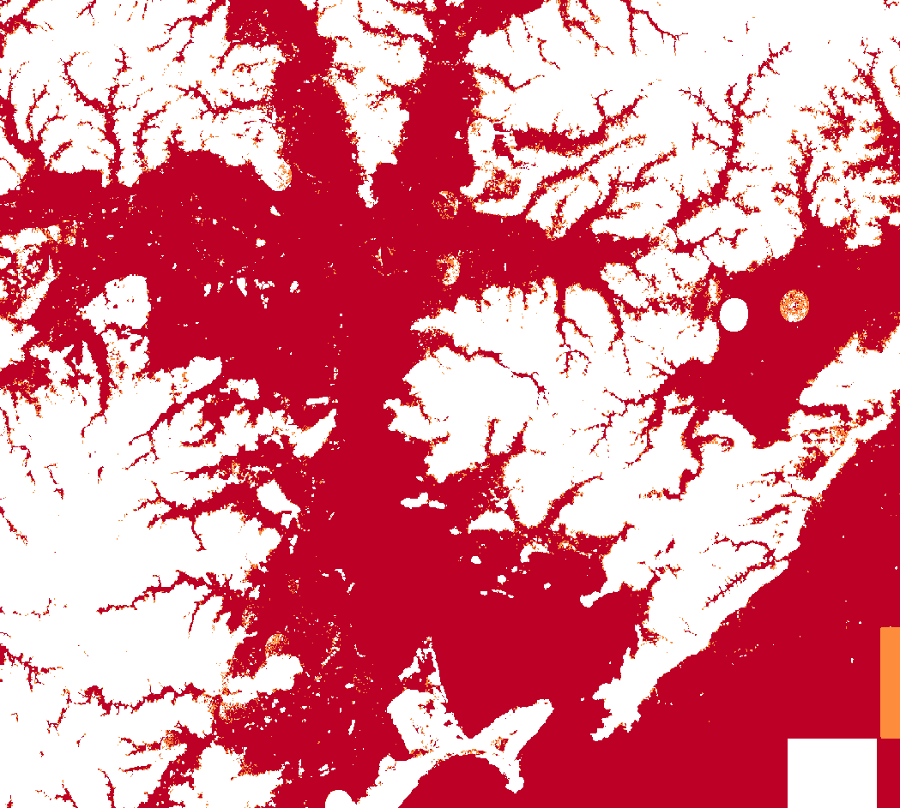

# REPLAY v2 — RS 2024 / WA 2025 (L44)

v2 re-scores the RS 2024 and WA 2025 replays to remove two v1 artifacts:
**~10 km stair steps** in the rain-score input and **finite TPI over
permanent water**. Nothing v1 is touched — all products publish as
`*_v2` side by side and every re-scored headline lives only under
`cases.<c>.replay_v2` in `data/metrics.json`.

## Diagnosis

- v1 `R` was computed in Earth Engine at ~1 km from IMERG 0.1° 3-day sums
  plus a percentile asset exported at 10 km with **NEAREST** resampling
  (`gee/tpi.py`, no `.resample('bilinear')`). The 10 km steps baked into
  `data/<case>/cog/<case>_r_series_*.tif` and spread single wet IMERG cells
  over ~10 km blocks, inflating Alto+/Crítico area and warned shares.
- v1 had **no permanent-water mask**, so the Guaíba lagoon, the Jacuí
  floodplain and large lakes carried finite TPI (mostly Crítico, since
  T_flood = HAND ≈ 1 there).

## Method

- **R**: computed locally on the 90 m TPI grid. `P3` = 3-day IMERG sum over
  `[D−3d, D)` (observed-band convention, `docs/conventions-dates.md`) from
  the upstream `imerg_daily.npz` cubes (0.1°; GEE `NASA/GPM_L3/IMERG_V07`
  = GES DISC exact). `p90/p95/p99` = the case climatology **per 0.1° cell**:
  2001–2023, 3-day sums ending `D±30d` step 3 (same windows as
  `tools/upstream_rescore.py climatology()`, applied cell-wise; ≥300
  complete windows required). P3 and each percentile are **bilinear**
  interpolated to the 90 m grid (cell centres) and scored with the
  unchanged `live.tpi.rain_score` piecewise function.
- **S**: the case `s_series` COG bilinear to 90 m — same recipe as v1.
- **T**: the existing `t_slide` / `t_flood` COGs.
- **TPI** unchanged: `(R·S·T)^(1/3)` (`tpi_weights` from `tp.config`).
- **Permanent water → NaN**: JRC GSW `occurrence` ≥ 50 % exported at 30 m
  for the case bbox (tiles `60W/50W_20S/30S` for RS, `130W_50N` for WA),
  **max-resampled** to the 90 m TPI grid, OR'ed with **MCD12Q1 IGBP class
  17** (GEE `MODIS/061/MCD12Q1/<event year>_01_01`, ~500 m, max-resampled).
  RS: 311,658 GSW cells + 253,628 MCD cells → 318,066 masked cells
  (6.9 % of finite-TPI area). WA: 325,435 GSW + 0 MCD → 325,170 (12.9 %).
- **Issued GFS frames** (L28b): band `d<k>` of issue `I` depicts `E = I+k`,
  summing calendar days `E−2..E` — observed IMERG for days `< I`, the GFS
  `I` 00Z run (`gfs_issued.npz`, 0.25°, bilinear) for days `≥ I`;
  percentiles at `E`; `S` held at the `s_series` band dated `I−1`.
- **people_critical**: `_critical_stats` on the v2 bands; population from
  the native 30″ GPW v4.11 2020 raster cropped to the grid for RS (the
  people-fix path), the case `pop_gpw` COG for WA (native raster's bounds
  check failed for the WA grid — recorded in `people_critical_source_v2`).

## Verification

Domain-mean `R` v1 vs v2 over the observed series (finite-both cells):

| case | mean R v1 | mean R v2 | Δ |
|---|---|---|---|
| rs_2024 | 0.11961 | 0.12445 | +4.0 % |
| wa_2025 | 0.11961 | 0.12445 | +4.0 % |

Per-day (rs_2024): smooth-day agreement is tight where rain matters —
2024-04-30 0.820→0.849 (+3.5 %), 05-01..05-03 1.0→1.0, 05-05 0.947→0.956;
low-mean days differ more in relative terms (0.071→0.102 on 04-28) because
bilinear reweights exactly which cells cross the p90 step. v2 is smoother
and slightly wetter at block edges — consistent with removing nearest-
resampled 10 km plateaus, not a bias.

Water-mask check: `TPI = NaN` on 318 k (RS) / 325 k (WA) permanent-water
cells, incl. the Guaíba lagoon — visible bottom-centre of the crops below.

`docs/img/replay_v2_rs_2024_flood_20240502_{v1,v2}.png` — TPI_flood class
map, Porto Alegre + Guaíba, 2024-05-02 (EPSG:3857, app palette; white =
nodata/below-0.4). v2: lagoon + river channels are NaN and the coarse
plateau boundaries are gone.

| v1 | v2 |
|---|---|
|  |  |

## Before / after (headlines)

rs_2024:

| key | v1 | v2 |
|---|---|---|
| slide_warned_pct | 36.45 | 5.77 |
| slide_warned_critical_pct | 1.87 | 0.18 |
| slide_warned_observed_pct | 0.25 | 0.59 |
| slide_warned_gfs_24h_pct | 36.45 | 5.77 |
| slide_warned_gfs_24h_critical_pct | 1.87 | 0.18 |
| slide_warned_gfs_48h_pct | 0.0 | 0.0 |
| slide_warned_gfs_72h_pct | 0.0 | 0.0 |
| forecast_lead_time_onset.earliest_critical_issue | None | 2024-04-23 |
| forecast_lead_time_onset.would_have_warned_h | None | 147.0 |
| forecast_lead_time_onset.lead_h_median | None | 87.0 |
| forecast_lead_time_onset.n_warned | None | 2 |
| forecast_lead_time_onset.n_issue_days | None | 7 |
| flood_ems_iou | 0.185 | 0.1967 |
| flood_ems_f1 | 0.3123 | 0.3288 |
| flood_ems_precision | 0.4645 | 0.7478 |
| flood_ems_recall | 0.2352 | 0.2107 |
| flood_ems_flagged_before_onset_pct | 6.56 | 0.0 |
| flood_ems_flagged_before_onset_critical_pct | 0.1 | 0.0 |
| landslide_ems_warned_observed_pct | 31.99 | 5.03 |
| landslide_ems_warned_observed_critical_pct | 0.0 | 0.0 |
| landslide_ems_warned_gfs_24h_pct | 81.09 | 0.0 |
| landslide_ems_warned_gfs_48h_pct | 0.0 | 0.0 |
| landslide_ems_warned_gfs_72h_pct | 0.0 | 0.0 |
| landslide_ems_warned_gfs_24h_critical_pct | 20.72 | 0.0 |
| slide_warned_gfs_24h_area_share_pct | 4.16 | 2.13 |
| slide_warned_gfs_24h_critical_area_share_pct | 0.29 | 0.11 |
| slide_warned_gfs_24h_lift | 8.76 | 2.71 |
| slide_warned_gfs_24h_critical_lift | 6.45 | 1.64 |
| landslide_ems_warned_gfs_24h_area_share_pct | 26.72 | 0.0 |
| landslide_ems_warned_gfs_24h_critical_area_share_pct | 2.4 | 0.0 |
| landslide_ems_warned_gfs_24h_lift | 3.03 | None |
| landslide_ems_warned_gfs_24h_critical_lift | 8.63 | None |
| landslide_ems_warned_gfs_24h_centroid_pct | 56.94 | 0.0 |
| flood_ems_flagged_before_onset_area_share_pct | 2.94 | 0.0 |
| flood_ems_flagged_before_onset_lift | 2.23 | None |
| alarm_precision_critical_pct | 33.68 | 34.81 |
| alarm_precision_critical_n_alarms | 971 | 948 |
| alarm_precision_critical_n_hits | 327 | 330 |
| alarm_precision_alto_plus_pct | 31.38 | 32.18 |
| alarm_pod_before_onset_pct | 100.0 | 100.0 |
| alarm_lift | 1.35 | 1.4 |
| critical_km2 | 10870.642 | 9174.578 |
| critical_km2_date | 2024-05-03 | 2024-05-03 |
| critical_slide_km2 | 3223.806 | 3218.664 |
| critical_flood_km2 | 7646.837 | 5955.914 |
| people_critical | 1488833 | 1627862 |

wa_2025:

| key | v1 | v2 |
|---|---|---|
| flood_warned_pct | 0.0 | 0.0 |
| flood_warned_critical_pct | 0.0 | 0.0 |
| flood_warned_observed_pct | 0.0 | 0.0 |
| flood_warned_gfs_24h_pct | 0.0 | 0.0 |
| flood_warned_gfs_48h_pct | 0.0 | 0.0 |
| flood_warned_gfs_72h_pct | 0.14 | 0.0 |
| forecast_lead_time_onset.earliest_critical_issue | None | 2025-12-03 |
| forecast_lead_time_onset.would_have_warned_h | None | 128.0 |
| forecast_lead_time_onset.lead_h_median | None | 80.0 |
| forecast_lead_time_onset.n_warned | None | 5 |
| forecast_lead_time_onset.n_issue_days | None | 8 |
| flood_warned_gfs_24h_area_share_pct | 0.0 | 0.16 |
| flood_warned_gfs_24h_critical_area_share_pct | 0.0 | 0.01 |
| flood_warned_gfs_24h_lift | None | 0.0 |
| alarm_precision_critical_pct | 19.7 | 20.29 |
| alarm_precision_critical_n_alarms | 66 | 69 |
| alarm_precision_critical_n_hits | 13 | 14 |
| alarm_precision_alto_plus_pct | 16.67 | 17.07 |
| alarm_pod_before_onset_pct | 100.0 | 100.0 |
| alarm_lead_h_median | 56.0 | 44.0 |
| alarm_lift | 1.97 | 2.03 |
| critical_km2 | 4127.458 | 3428.689 |
| critical_km2_date | 2025-12-12 | 2025-12-12 |
| critical_slide_km2 | 2662.718 | 2690.04 |
| critical_flood_km2 | 1464.74 | 738.649 |
| people_critical | 229782 | 196670 |

The complete key-by-key table (including the per-lead observed/GFS cells,
SMAP-latency sensitivity rows and the `prediction_lift`/`alarm_precision`
detail blobs) is in `data/metrics.json` under
`cases.<c>.replay_v2.before_after` with `detail` per tool.

## What changed and what it means

- The 10 km blocks are gone — Alto+/Crítico area shares halved in RS
  (`slide_warned_gfs_24h_area_share_pct` 4.16 → 2.13) and the spurious
  GFS-24h coverage of the Taquari-valley EMS AOIs
  (`landslide_ems_warned_gfs_24h_pct` 81.09 → 0.0) is removed: v1 had
  smeared a high-R block over the valley a day ahead; v2 shows the issue
  2024-04-28 frames flag only 5.77 % of inventory cells and none of the
  EMS polygons at Crítico.
- The flood-plain/lagoon artifacts are gone — `flood_ems_precision`
  0.46 → 0.75 (fewer false positives over permanent water) while
  `critical_flood_km2` drops 7647 → 5956 (RS) and 1465 → 739 (WA), mostly
  masked lagoon/lake cells that v1 scored Crítico.
- `critical_km2` drops ~16 % (RS) / ~17 % (WA); `people_critical` moves
  mainly with the native-GPW denominator (RS) and the mask.
- WA `flood_warned_*` stays ~0 — the pixel-local-R explanation from v1
  holds: upstream Cascade rain drives the valley flooding and the index
  rises only after onset.
- Both cases now have `forecast_lead_time_onset` values (earliest
  critical issue, would-have-warned hours) that v1 did not emit.

## Reproduce

```sh
set -a; . ../tipping-point-data/.env; set +a
PYTHONPATH=.:pipeline python tools/replay_v2.py --case rs_2024 --case wa_2025
PYTHONPATH=.:pipeline python tools/replay_v2_score.py --build-report <build.json>
PYTHONPATH=.:pipeline python tools/replay_v2_png.py --band-date 20240502
```

All six scoring tools also accept `--cog-suffix _v2` directly (dry-run;
`--write` with a suffix is refused so v1 keys cannot be overwritten).
